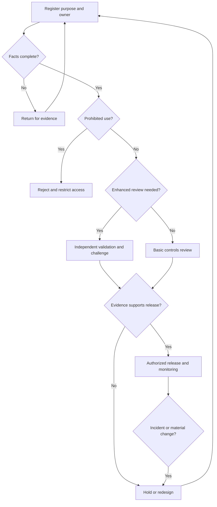

# AI review process

Synthetic operating design. Proposed service targets start only when the packet is complete; they never create automatic approval.

| Gate | Required record | Decision authority / proposed target |
| --- | --- | --- |
| Intake | Purpose, benefit, alternatives, owner, users, affected people, data, vendor, geography, actions | Governance office checks completeness / 2 business days |
| Classification | Legal category plus separate internal risk, uncertainty and rationale | Legal interpretation and risk challenge / 5 business days |
| Evaluation | Test plan, independent results, impact assessment and supplier evidence | Validation and control specialists / agreed case plan |
| Release | Version-bound decision, accepted limits, expiry, monitoring, rollback, ownership | Business executive within delegation; committee for enhanced cases |
| Operation | Errors, harm indicators, overrides, complaints, incidents and version changes | First-line owner; monthly second-line challenge |
| Retirement | Access revoked, dependencies removed, records retained/deleted under approved schedule | Business and data owners; verified closure |

For HB-003 the classification gate is complete on assumed facts, but evaluation is incomplete. DEC-003 holds live release. A lower target risk score cannot bypass the gate. For HB-009 the process returns to intake because profiling and decision influence remain unknown.

Approval records must include identity, role, authority basis, version, scope, evidence references, timestamp, conditions and expiration. A document saying “human approved” without identity and authority is insufficient.
